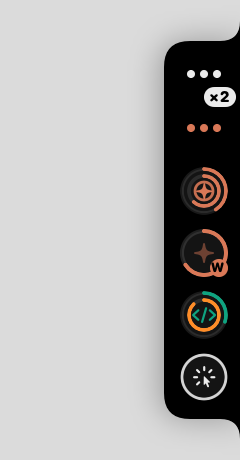
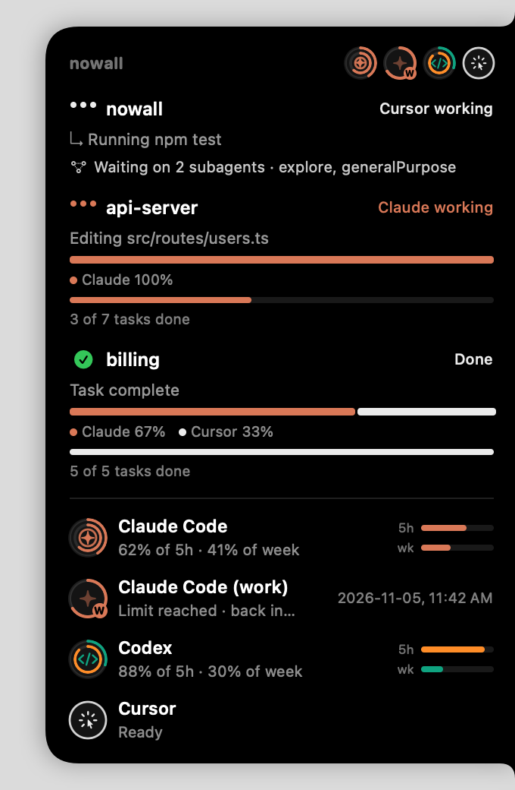

# nowall

Automatic failover for AI coding agents on macOS and Windows, with a live status notch on macOS.

When Claude Code hits its usage limit mid-task, nowall saves your work and continues the task in the next coding agent you're signed in to, with the full context. A small notch on the edge of your screen shows what each agent is doing.

<p align="center">
  
  &nbsp;&nbsp;
  
</p>

When the task finishes, you get one summary:

```
Your task is done. The last part was built by Cursor because Claude Code hit its session limit (resets 11:59 PM).

  1. Claude Code: 3 files changed, 120 insertions(+) (hit session limit)
  2. Cursor: 2 files changed, 64 insertions(+) (finished)
```

nowall runs entirely on your computer. It has no account, server or telemetry, and each agent keeps its own login.

> **nowall is new. If something doesn't work, please [report it](https://github.com/Vedthakar/nowall/issues/new).** Even a one-line report helps.

## Requirements

- **Node.js 20 or newer** and **git**
- **macOS 13 or newer** for the notch (Apple Silicon or Intel)
- **Linux:** the CLI and failover are built to work but haven't been tested there yet, and there is no notch
- **Windows 10 or 11:** the CLI and failover, with Git for Windows. There is no notch yet. See [Windows](#windows)
- **A git repository for failover:** chats in other folders still show in the notch, but can't be taken over
- **At least two agents** for failover, for example Claude Code and the Cursor CLI

## Install

```bash
curl -fsSL https://raw.githubusercontent.com/Vedthakar/nowall/main/install.sh | sh
```

On a Mac, this opens the **setup window**, and that's all you need. It walks you through:

1. **Agents:** finds what you have, with buttons to sign in or install the rest.
2. **Priority:** drag your accounts into takeover order, and add a second account if you have one.
3. **Hotkeys:** one to switch agents, one to cancel a switch.

Then the notch appears on the right edge of your screen. There is nothing to configure per project.

In the Agents step, finish these two if you use Claude Code. They need you, in a terminal, and the setup window opens both for you:

- **Sign in to terminal Claude.** The desktop app has its own login, and Claude can't take over a task without this one.
- **Send one message in terminal Claude.** Claude only reports usage there, so its usage rings stay plain until you do.

nowall never signs in for you and never handles your agent logins. To change anything later, right-click the notch and open **Settings**.

### Set it up with an agent

Prefer to have a coding agent do it? Paste this prompt into Claude Code, Cursor or similar:

```text
Install nowall on this computer and help me finish setting it up.

1. Mac or Linux: run this. On a Mac it opens a setup window and waits until I finish it, so tell me the window is open and don't stop the command or treat it as stuck. Allow at least 15 minutes.
   curl -fsSL https://raw.githubusercontent.com/Vedthakar/nowall/main/install.sh | sh
   Windows: run this in PowerShell.
   irm https://raw.githubusercontent.com/Vedthakar/nowall/main/install.ps1 | iex
2. If no window can open (Linux, or over SSH), the installer sets up in the terminal instead. If it stops to ask something, run: nowall setup --yes
3. Run these and read the output: nowall agents, then nowall account verify
4. Tell me in plain words which coding agents are ready, and give me the exact command for any I still need to sign in to. I'll run sign-ins myself.

Never ask for, read or print my logins, tokens or API keys.
```

### Other ways to install

On Windows, run this in PowerShell. There's no setup window there yet, so setup runs in the terminal:

```powershell
irm https://raw.githubusercontent.com/Vedthakar/nowall/main/install.ps1 | iex
```

To review each step yourself, install by hand:

```bash
npm install -g https://github.com/Vedthakar/nowall/releases/latest/download/nowall.tgz
```

```bash
nowall setup
```

On a Mac, `nowall setup` opens the same window. Add `--cli` to stay in the terminal.

### Try it first

To see a full failover without using any real agent or usage, run this after installing:

```bash
nowall demo
```

## Supported tools

| Tool | Shown in the notch | Limit starts a failover | Can take over a task | Tested against |
|---|---|---|---|---|
| Claude Code (desktop app) | Yes | Yes | No (needs the CLI) | Real app |
| Claude Code (CLI) | Yes | Yes | Yes | Real CLI |
| Cursor (`cursor-agent`) | Yes | Only while taking over | Yes | Real CLI |
| Cursor (IDE chats) | Yes | No | No | Real app |
| Codex CLI | Yes | Only while taking over | Yes | Simulated |
| Antigravity CLI (`agy`) | While taking over | Only while taking over | Yes | Simulated |
| Qwen Code, with your own key | While taking over | Only while taking over | Yes (opt-in) | Simulated |

"Simulated" means the tool's documented formats are covered by automated tests, but it has not yet run against a real install. Reports are welcome.

Gemini CLI stopped serving personal Google accounts in June 2026. Antigravity CLI replaces it for those accounts.

## The notch

The notch is a small black tab on the right edge of your screen. It shows one symbol per active session, then one icon per account.

| Symbol | Meaning |
|---|---|
| Bouncing dots | An agent is working |
| Wiggling speech bubble | An agent needs your input |
| Rotating arrows | Switching agents |
| Check mark | Finished |
| Rings around an account icon | Usage: outer ring is weekly, inner ring is the short window. Orange past 85% |
| Single ring refilling | The account is cooling down until its limit resets |

- **Click a bubble** to open that chat, in the Claude app or its terminal tab. Hover to see which chat it is.
- **Double-click anywhere on the notch**, circles included, to see each session's repo and current activity, who built what, task progress, and every account's status.
- **Right-click** to switch to a chosen account or cancel a switch, or for Settings (accounts and takeover order), refresh, hide for an hour, or quit.
- **Cancel switch** on a session in the open notch stops its takeover. Its edits stay in your files, and `nowall undo` can roll them back.
- **`nowall notch off`** hides it until you run `nowall notch on`. Failover keeps working either way.

Clicks outside the notch pass through to whatever is underneath.

A finished chat keeps its check mark until you click it. When more chats are running than fit, the rest show as "+N", and one that finishes or needs you swaps in for one that's still working.

## Windows

Windows support is new. The CLI, hooks, failover, multiple accounts, undo and uninstall are built to work as they do on a Mac, but so far they've only been tested with simulated agents, not real agent installs. Reports are welcome. A few things differ:

- **No notch or setup window yet.** Setup runs in the terminal. Use `nowall status` to see where things stand and `nowall logs -f` to follow a takeover.
- **Takeovers always run in the background.** `"takeover": "terminal"` falls back to `background`.
- **`nowall open` only prints the session's folder**, and the `claude` shell shortcut from `nowall init --alias` isn't available. Use `nowall run claude`.
- **In PowerShell, use `nowall.cmd`** if `nowall` is blocked by your execution policy.
- **A Cursor API key** is stored in a file only your Windows user can read, not in a credential vault.
- **Claude Code may flash a console window** each time it runs a hook. That comes from how Claude Code starts hooks on Windows, not from nowall.
- **Cursor's own hooks have open Windows bugs,** especially with Git Bash, so its chats may not show up in `nowall status`. Cursor can still take over a task.

## How failover works

1. **Record.** Hooks add short lines to `.handoff/journal.jsonl` in each repo: your requests, files edited, commands run, and finished tasks. This costs roughly 100–300 tokens per session. The folder is git-ignored and secrets are redacted.
2. **Detect.** Claude Code's `StopFailure` hook reports the limit and its reset time. Agents that are taking over are watched through their structured output.
3. **Checkpoint.** Your files are saved to a hidden git ref (`refs/nowall/…`). Your branches, index and files aren't touched, and these refs aren't pushed by `git push` or `git push --all`.
4. **Hand off.** The next account that is installed, signed in and not cooling down receives the goal, decisions, task list, and the diff since the session began.
5. **Verify.** Its first job is to check each "done" claim against `git diff` and write a verified task list. Then it keeps working in the background.
6. **Stop.** It stops when no tasks remain, nothing has changed for a few turns, or it reaches the turn or time limit. If every account is limited, it pauses and shows the earliest reset.

Leave the original Claude session idle until the takeover finishes, so that two agents don't edit the same files. `nowall logs -f` shows live progress.

### What a takeover can do

Agents that take over run unattended, so they get edit-only permissions by default. They can change files in the repo, but may not be able to run commands, tests or commits. To give them full access, opt in:

```bash
nowall setup --yolo
```

With `--yolo`, an unattended agent can run any command on your computer. Use it only with repositories you trust.

## Multiple accounts

If you have more than one subscription, nowall can move through your accounts before it switches tools:

```bash
nowall account add claude work
```

```bash
nowall account add cursor team
```

```bash
nowall order claude claude:work cursor cursor:team codex
```

Or use **Add account** in Settings. For Cursor it opens the website: sign in with the other account and you're done. Claude Code and Codex open their sign-in in Terminal. The label is optional.

- Each account gets its own profile folder and keeps its own login, apart from your main one. Cursor keeps these in its own `auth.json` inside that folder.
- If your browser is already signed in to your main account, log out on the website first. nowall won't add the same account twice.
- Prefer a Cursor API key? `nowall account add cursor team --api-key` keeps it in the macOS Keychain (elsewhere, a file only your user can read) and only passes it to `cursor-agent`.
- Limits are tracked per account, so `claude:work` stays available while `claude` is cooling down.

## Commands

| Command | Description |
|---|---|
| `nowall setup` | Turn nowall on for every repo, find agents, start the notch |
| `nowall tour` | Show how to read the notch, plus the main commands |
| `nowall demo` | Run a simulated failover with no real usage |
| `nowall agents` | List agents with sign-in, cooldown and usage details |
| `nowall status` | Show accounts, the last session and its checkpoints |
| `nowall switch [--latest] [--to <account>]` | Hand a session to the next account now (also the hotkey, `⌃⌥⌘N` by default) |
| `nowall cancel` | Stop a running takeover and keep its edits (also a button on the open notch, and the hotkey `⌃⌥⌘X` by default) |
| `nowall pause [30m\|2h\|1d]` / `nowall resume` | Stop every takeover for a while, or end the pause |
| `nowall off` / `nowall on` | Stop or allow takeovers in this repo |
| `nowall logs [-f]` | Show or follow a background takeover in this repo |
| `nowall undo [n]` | List checkpoints, or restore files to one. Never deletes files |
| `nowall order [id ...]` | Show or set the takeover order |
| `nowall account add\|list\|remove\|login\|verify` | Manage extra accounts (`add` opens the sign-in) |
| `nowall notch [on\|off\|status]` | Show, hide or diagnose the notch |
| `nowall run <agent>` | Run an agent under nowall in this terminal (optional) |
| `nowall init` | Set up a single repo instead of all of them |
| `nowall uninstall --global` | Remove nowall from this computer |

## Configuration

Settings live in `~/.config/nowall/config.json` (on Windows, `%USERPROFILE%\.config\nowall\config.json`). The notch's Settings window and `nowall order` edit the order for you.

```json
{
  "order": ["claude", "cursor", "codex", "antigravity"],
  "takeover": "background",
  "yolo": false,
  "stop": { "maxTurns": 30, "maxMinutes": 120, "noDiffTurns": 3 }
}
```

| Key | Description |
|---|---|
| `order` | Accounts in takeover order. Any account left out is off |
| `takeover` | `background` (silent, the default), `terminal` (opens a Terminal window) or `off` |
| `yolo` | Give agents that take over full access. Off by default |
| `hotkey`, `cancelHotkey` | Shortcuts for switch and cancel, such as `ctrl+alt+cmd+n`, or `false` for off. Plain shortcuts like `cmd+n` are ignored, because they'd take over normal typing and app commands |
| `stop` | Limits on how long an unattended takeover can run |

## Privacy and security

- **Local only.** nowall sends nothing anywhere. Your code goes only to the agents you already use, under their terms.
- **Credentials.** nowall doesn't read agent logins. Each agent keeps its own, including in the separate profile folders it gets for extra accounts. nowall stores one thing itself: a Cursor API key, only if you add one on purpose.
- **Redaction.** API keys, tokens, private keys, URL credentials and the values in your `.env` files are stripped from everything nowall writes.
- **Snapshots.** Files matched by `.gitignore`, plus files such as `.env*`, `*.pem` and `*.key`, are left out of checkpoints.
- **Untrusted repos.** nowall refuses repos that commit or symlink a `.handoff/` folder. Like any coding agent, an agent that takes over can still be influenced by what a repo contains.
- **China-hosted models** (DeepSeek, Kimi, GLM through Qwen Code) stay off unless you confirm a clear notice.

The security review is in [docs/SECURITY.md](docs/SECURITY.md).

## Uninstall

Remove the hooks and the notch, and keep your settings for a later reinstall:

```bash
nowall uninstall --global
```

Remove everything, including settings, extra account profiles and Keychain items, plus the handoff history in your repos and the npm package:

```bash
nowall uninstall --global --purge --repos --npm
```

Add `--dry-run` to either command to see what would change. Your own hooks and status line are left as they were.

## Known bugs

- **Claude's usage rings stay a plain circle until you run a terminal `claude` turn.** The desktop app doesn't report usage. Run `claude` in a terminal and send one message. The rings then show the numbers from your latest terminal turn, and clear when that usage window resets. Limits are still detected either way.
- **Terminal Claude can't take over tasks until you run `claude auth login`.** Being signed in to the desktop app doesn't sign in the terminal version.

## Known limitations

- Cursor doesn't report usage in advance, so nowall only learns an account is out when a takeover hits the limit. Detection uses the wording in Cursor's own app, but hasn't met a real limit on the CLI yet. If the wording differs, nowall moves on to the next account after two failed tries, so please [report the message](#report-an-issue).
- A Cursor API key isn't checked when you add it, so a wrong key can show as signed in. Check one with `nowall account verify <id>`. During a takeover, an account whose login fails is skipped.
- An extra Cursor account runs with its own home folder, so a takeover on it doesn't load your `~/.cursor` rules or MCP servers. Your git identity stays the same.
- Cursor doesn't expose usage locally, so its circle has no rings.
- Claude sessions that run in the cloud don't show in the notch. They leave nothing on your computer, and reaching them would mean reading your login, which nowall never does.
- Clicking a Cursor IDE chat opens its workspace, not the exact chat.
- Failover starts from Claude Code. A limit inside the Cursor IDE or an interactive Codex session doesn't start one yet.
- A takeover runs in the background, and you can't type to it. Run the resume command in the summary to continue interactively.
- The original Claude session isn't closed by a background takeover, so it can resume after its limit resets.
- The notch isn't available on Linux or Windows yet.

See the [roadmap](docs/ROADMAP.md) for what's planned.

## Development

```bash
npm install
```

```bash
npm run lint && npm run typecheck && npm test
```

```bash
npm run stress
```

Tests never use real agents: `scripts/fake-agent.mjs` reproduces their output formats, limit errors and expired logins. `npm run build:notch` builds the macOS app and needs the Xcode command line tools. CI also installs nowall with `install.ps1` on Windows and runs `npm run smoke:windows`, which runs the hooks under cmd.exe, PowerShell and Git Bash.

## Report an issue

Please [open an issue](https://github.com/Vedthakar/nowall/issues/new) for anything that breaks, confuses you or doesn't match this README. Reports about real limits are especially useful, including the exact message an agent showed when it ran out. Pull requests are welcome too.

It helps to include:

- What you did, and what happened instead
- `nowall --version`, your OS, and which agents you use
- The output of `nowall account verify`, and `nowall logs` if a takeover was involved

Check these for anything private before you post them. Run from a repo, `nowall logs` can include file paths and what the agent said.

## License

[MIT](LICENSE)
