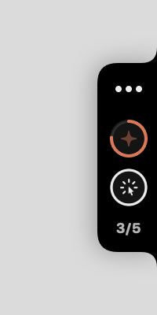
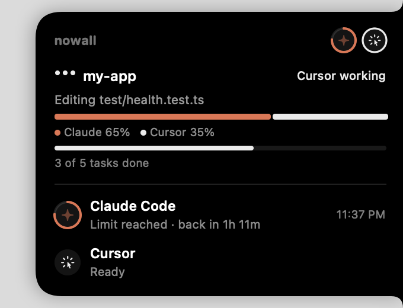

# nowall

**A tiny macOS notch that shows what Claude Code is doing, plus automatic failover: when Claude hits its usage limit mid-task, your Cursor account finishes the job.**

<p align="center">
  
  &nbsp;&nbsp;
  
</p>

You keep working in Claude Code as usual (desktop app or terminal). A small black notch on the right edge of your screen shows what's happening: Claude working, needs your input, done. Hover it for details. If Claude hits its limit, nowall quietly hands the task to Cursor (or Codex or Antigravity) with the full context, and you get one summary when it's finished:

```
Your task is done. The last part was built by Cursor because Claude Code hit its session limit (resets 11:59 PM).

  1. Claude Code: 3 files changed, 120 insertions(+) (hit session limit)
  2. Cursor: 2 files changed, 64 insertions(+) (finished)
```

Runs entirely on your computer. No account, no server, and nowall never touches your credentials.

## Status: early, but it works

I built this for myself at a hackathon. The full flow has run for real: Claude hit its monthly limit mid-task and Cursor finished it (14 files). It has 150 tests, a security review ([docs/SECURITY.md](docs/SECURITY.md)) and a stress suite.

| Works today | Not yet |
|---|---|
| macOS (Apple Silicon and Intel) | Windows/Linux notch (failover itself works on Linux) |
| Claude Code (desktop app or CLI) → Cursor | Codex and Antigravity are supported but less tested |
| Silent takeover, checkpoints, `nowall undo` | Proactive handoff before the limit |

Bugs and ideas are welcome in [issues](https://github.com/Vedthakar/nowall/issues), and PRs even more so.

## Install

You need Node 20+ and macOS. Then:

```bash
curl -fsSL https://raw.githubusercontent.com/Vedthakar/nowall/main/install.sh | sh
```

That installs the prebuilt package (no build tools needed). It finds your agents on its own, hooks into Claude Code and Cursor once (which covers every project), and starts the notch.

The only thing it can't do is sign in for you. If Cursor isn't signed in yet:

```bash
cursor-agent login
```

Prefer to see what you're running first? Install the release package directly with npm, then run setup:

```bash
npm install -g https://github.com/Vedthakar/nowall/releases/latest/download/nowall.tgz
```

```bash
nowall setup
```

Change your mind? `nowall uninstall --global` removes everything.

### Or let Claude install it

Paste this into Claude Code:

> Install nowall on this computer: run `curl -fsSL https://raw.githubusercontent.com/Vedthakar/nowall/main/install.sh | sh`. Then run `nowall agents` and tell me which coding agents it found, and the exact command for any agent I still need to sign in to.

## See it without spending any usage

```bash
nowall demo
```

This runs a full simulated failover in a throwaway repo: Claude hits its limit, Cursor finishes the job, and you get the summary.

## The notch (macOS)

A small black notch on the right edge of your screen, vertically centered. It's shaped like the MacBook notch turned on its side.

- **Collapsed:** a slim tab with what's happening on top, then one icon per agent.
  - Bouncing dots: an agent is working.
  - A wiggling bubble: an agent needs your input.
  - A spinning swap: switching agents.
  - A check: done.
  - A ring around an agent's icon: it's cooling down, and the ring refills as its reset approaches.
- **Hover:** it grows smoothly leftward into a card with each task's repo, what the agent is doing, a "who built what" bar (e.g. Claude 65% · Cursor 35%), task progress, and every agent's status: ready, not signed in, usage used, or time until its limit resets. Hover an agent icon and it pops out.
- **Right-click:** refresh, hide for an hour, or quit.
- **Off and on:** `nowall notch off` hides it until you run `nowall notch on` (it stays off across restarts and re-running setup). nowall keeps working either way. `nowall notch status` diagnoses it.

Clicks anywhere outside the notch go straight through to whatever is underneath. Windows and Linux versions are on the [roadmap](docs/ROADMAP.md).

## How it works

1. **Journal.** Hooks log tiny lines to `.handoff/journal.jsonl` in each repo (git-ignored): your requests, files edited, commands run, and one line per finished task. That costs about 100–300 tokens per session. Secrets are redacted.
2. **Detect.** Claude Code's `StopFailure` hook fires on a usage limit, and nowall reads the exact reset time. Other agents are watched through their structured output.
3. **Checkpoint.** Your files are snapshotted to a hidden git ref (`refs/nowall/…`). Your branches, index and files are untouched, and the snapshots are never pushed.
4. **Hand off.** The next agent in your order that is installed, signed in and not cooling down gets the goal, decisions, claimed-done tasks, remaining tasks, and the git diff since the session began.
5. **Reconcile.** Its first job is to check every "done" claim against `git diff` (git is the truth; the journal is a hint), write a verified task list, and then keep working.
6. **Stop.** It stops when no tasks remain, nothing changed for a few turns, or it hits max turns or max time. If every agent is limited, it pauses and shows when the first one resets.

## Supported agents

| Agent | Role | Status |
|---|---|---|
| Claude Code (desktop app or CLI) | Primary | Stable |
| Cursor CLI (`cursor-agent`) | Takes over | Beta |
| Codex CLI | Takes over | Beta |
| Antigravity CLI (`agy`) | Takes over | Beta (replaces Gemini CLI for personal Google accounts since 2026-06-18) |
| Qwen Code with your own key | Opt-in fallback | Beta, off by default |

## Commands

| Command | What it does |
|---|---|
| `nowall setup` | Turn nowall on everywhere, find your agents, start the notch |
| `nowall agents` | What nowall found: sign-in, cooldowns, usage |
| `nowall demo` | Simulated failover, no real usage |
| `nowall status` | Agents plus the last session and its checkpoints in this repo |
| `nowall logs [-f]` | What a background takeover did (or is doing) here |
| `nowall undo [n]` | Roll files back to the end of step *n* (never deletes files) |
| `nowall notch on` / `off` | Show or hide the notch (off is remembered) |
| `nowall run claude` | Run terminal Claude under nowall (optional; hooks cover it anyway) |
| `nowall init` | Per-repo mode instead of `setup` |
| `nowall uninstall --global` | Remove everything `setup` added |

## Privacy and safety

- **Local only.** Work continues only through agents you have installed and signed in to yourself.
- **No credentials.** nowall never reads, stores or asks for agent logins or API keys.
- **Redaction.** API keys, tokens, JWTs, private keys, URL credentials, and the values in your `.env` files are stripped from everything nowall writes.
- **Undoable.** Every handoff is checkpointed. Undo never deletes files.
- **Safe defaults.** Agents that take over run edit-only. Full auto-approve is opt-in (`nowall setup --yolo`).
- **China-hosted models** (DeepSeek, Kimi, GLM via Qwen Code) stay off unless you type "yes" after a clear notice.

The full pen-test report is in [docs/SECURITY.md](docs/SECURITY.md).

## Configuration

`~/.config/nowall/config.json`:

```json
{
  "order": ["claude", "codex", "cursor", "antigravity", "qwen"],
  "takeover": "background",
  "yolo": false,
  "stop": { "maxTurns": 30, "maxMinutes": 120, "noDiffTurns": 3 }
}
```

`takeover` can be `"background"` (silent; the default), `"terminal"` (open a Terminal window), or `"off"`.

## Development

```bash
npm install
```

```bash
npm test
```

```bash
npm run stress
```

The tests never touch real agents: `scripts/fake-agent.mjs` plays Claude, Codex and Cursor with their real output formats, limit errors and expired-login errors. `npm run build:notch` builds the macOS app (needs Xcode tools).

## License

MIT
