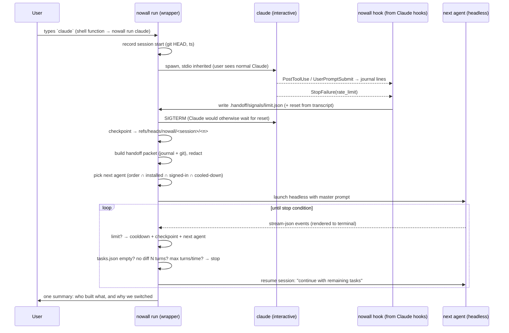

# Architecture (v0.1)

## 1. Language and distribution

| | TypeScript / Node | Go | Rust |
|---|---|---|---|
| Ships via `npx` (zero-install try) | **Yes** | wrapper needed | wrapper needed |
| Target CLIs' ecosystem | Codex, Gemini, Qwen are npm | — | — |
| Child-process + JSONL streaming | Fine (`node:child_process`, `readline`) | Great | Great |
| Startup latency on every `claude` | ~40 ms (acceptable) | ~5 ms | ~5 ms |
| Iteration speed for us | **Fastest** | Medium | Slow |

**Choice: TypeScript, Node ≥ 20, ESM, published to npm, `npx nowall`.** Research gave no reason to switch: everything we need is spawning processes and parsing JSON. **Zero runtime dependencies** in v0.1 (no `node-pty`, no native builds), which keeps install trivial and the supply-chain surface small. Dev tools: `typescript`, `vitest`, `@biomejs/biome` (lint + format in one tool).

## 2. Flow



**Why the destination runs headless in the same terminal:** we must supervise it (detect its limit, enforce stop conditions, re-prompt), and only headless modes give a reliable structured stream. Claude has already exited, so we own the TTY and render the agent's text output there. `Ctrl-C` stops supervision and prints the agent's native resume command so the user can take over interactively.

**Passthrough rule:** outside a `nowall init`-ed repo (no `.handoff/`), or for `claude --version`, `claude -p`, and similar, `nowall run claude` simply `exec`s the real binary. The alias never gets in the way.

## 3. Schemas

All in `src/schemas.ts` as TS types with runtime guards.

**Journal line** (`.handoff/journal.jsonl`, append-only, every line redacted):
```json
{"v":1,"ts":"2026-10-15T05:10:00Z","sid":"s_8f2c","agent":"claude","kind":"goal|edit|cmd|task|decision|limit|handoff","text":"short, ≤200 chars","files":["src/a.ts"],"status":"done|wip|todo"}
```
- `goal`: from `UserPromptSubmit` (mechanical, truncated).
- `edit`/`cmd`: from `PostToolUse` (mechanical, no model tokens).
- `task`/`decision`: model-written via `nowall note` (the context-file rule asks for one line per completed task). This is the only token cost, about 100–300 tokens per session.

**Handoff packet** (`.handoff/packets/<n>.json`, plus a rendered Markdown copy in the prompt):
```ts
{ v:1, sessionId, createdAt, from:{agent, reason:"limit", resetsAt?}, to:agent,
  goal: string[], decisions: string[], filesTouched: string[],
  claimedDone: string[], remaining: string[],      // from journal (hints)
  git: { baseRef, headRef, checkpointRef, status: string, diffStat: string, log: string[] },
  lastError?: string }
```

**Task list** (`.handoff/tasks.json`, written by the destination agent during reconciliation, read by the wrapper for stop conditions):
```ts
{ v:1, updatedAt, updatedBy, tasks: [{ id, title, status:"done"|"todo"|"blocked", evidence?: string }] }
```

**State** (`~/.config/nowall/state.json`):
```ts
{ v:1, agents: { [id]: { cooldownUntil?: ISO, lastLimit?: { window?, message, resetsAt?, observedAt },
                          usage?: { window, usedPct, resetsAt, observedAt }[] } } }
```

**Config** (`~/.config/nowall/config.json`):
```ts
{ v:1, order:["claude","codex","cursor","antigravity"], enabled:{...}, yolo:false,
  stop:{ maxTurns:30, maxMinutes:120, noDiffTurns:3 }, defaultCooldownMinutes:300,
  fallback:{ enabled:false, chinaConsent:false, provider?: "openrouter"|"deepseek"|"kimi"|"glm" } }
```

## 4. Wrapper and supervisor

- **Launch:** `spawn(realBinary, args, { stdio: "inherit", env: {...env, NOWALL_SID} })`. The real binary is resolved from `PATH` *excluding* our own shim.
- **Limit detection, layered, most reliable first:**
  1. **Hook signal file.** Claude `StopFailure` with matcher `rate_limit` makes `nowall hook claude-stop-failure` write `.handoff/signals/limit.json`. The wrapper polls the dir every 500 ms (`fs.watch` is unreliable on macOS for some editors; polling is cheap).
  2. **Structured stream** (headless agents): `is_error:true` (Claude), `turn.failed`/`error` (Codex), `error` events (Cursor, agy).
  3. **Text patterns** per adapter (`limits.ts`), run on stream text and stderr.
  4. **Exit code**, last, and only combined with 2 or 3.
- **Transient vs quota:** Claude's `429 … temporary capacity` and `Server is temporarily limiting` are **not** limit hits. We retry the same agent with backoff (max 2) before failing over.
- **Next agent:** `config.order` filtered by `enabled && installed && signedIn !== false && (cooldownUntil ?? 0) < now`, skipping the agent that just failed. If none is left, stop and report the earliest reset.
- **Stop conditions** (checked after every turn): `tasks.json` has no `todo`, OR no change in `git diff` hash for `noDiffTurns` turns, OR `maxTurns`, OR `maxMinutes`, OR all agents cooling down, OR user `Ctrl-C`.
- **Checkpoint before every handoff:** snapshot the working tree (tracked + untracked, respecting `.gitignore`) with a temporary `GIT_INDEX_FILE` → `write-tree` → `commit-tree -p HEAD` → `update-ref refs/heads/nowall/<sid>/<n>`. **It never touches the user's branch, index, or working tree.** `nowall undo [n]` restores files from a checkpoint.

## 5. Adapter interface

```ts
export interface AgentAdapter {
  id: AgentId;                     // "claude" | "codex" | "cursor" | "antigravity" | "qwen"
  displayName: string;
  binary: string;
  installHint: string;             // official install command (shown, never auto-run without consent)
  loginHint: string;               // e.g. "codex login"
  contextFile: string;             // CLAUDE.md / AGENTS.md / ...
  detect(run: Runner): Promise<{ installed: boolean; version?: string; signedIn: boolean | "unknown" }>;
  headless(opts: { prompt: string; resumeId?: string; yolo: boolean }): { args: string[]; env?: Record<string,string> };
  parseLine(line: string): AgentEvent[];        // stream-json → normalized events
  detectLimit(text: string, now: Date): LimitHit | null;
  installHooks?(projectDir: string): Promise<string[]>;   // returns files written
}
type AgentEvent =
  | { kind: "session"; id: string } | { kind: "text"; text: string }
  | { kind: "tool"; name: string; files?: string[] } | { kind: "error"; text: string; limit?: LimitHit }
  | { kind: "done"; isError: boolean; text?: string };
```
Adding an agent means adding one file in `src/adapters/` and registering it.

## 6. Reconciliation (master prompt)

Versioned template in `src/prompt.ts` (`MASTER_PROMPT_VERSION`). The destination agent's first job:

1. Read the packet below and `.handoff/journal.jsonl`.
2. Run `git status`, `git diff <baseRef>`, and `git log <baseRef>..HEAD`. **Git is the source of truth; the journal is only a hint.**
3. For each task the journal claims is done, find evidence in the diff. If there is none, mark it `todo` and say why.
4. Write `.handoff/tasks.json` (schema given inline).
5. Continue the remaining tasks. After each finished task, update `tasks.json` and run `nowall note`.
6. Don't ask the user questions unless you're truly blocked; don't revert prior work unless it's broken.

## 7. Redaction (`src/redact.ts`)

Applied to **everything we write**: journal, packets, prompts, summary, state, logs. Patterns: Anthropic/OpenAI/GitHub/Google/AWS/Slack/Stripe/npm keys, JWTs, `Bearer …`, PEM private-key blocks, `KEY=value` lines where the key name looks secret, URL credentials (`https://user:pass@`), values read from the repo's `.env*` files (exact-match), and optionally emails. Replace with `[REDACTED:<kind>]`. It is pure and synchronous, with heavy tests.

## 8. Setup (`npx nowall init`)

1. Show the consent text: what's written locally, the ~100–300 token/session journal cost, and that nothing leaves the machine except through the agents you already use.
2. Detect agents (installed, version, signed in) and print a table with install and login hints. **Never** handle credentials.
3. In the repo: create `.handoff/` (and add it to `.git/info/exclude`, never the user's `.gitignore`), install hooks:
   - Claude → `.claude/settings.local.json`: `UserPromptSubmit`, `PostToolUse`, `StopFailure`.
   - Codex → `.codex/hooks.json`: `PostToolUse` (journal only).
   - Append a short marked block to `CLAUDE.md` / `AGENTS.md` (the `nowall note` rule), only between `<!-- nowall:start -->` markers so it can be removed cleanly.
4. Offer the shell function in `~/.zshrc` (or `~/.bashrc`): `claude() { command nowall run claude -- "$@"; }`. Opt-in, with a marked block for clean removal (`nowall uninstall`).
5. Optional fallback: off by default, with the China consent screen when relevant.

## 9. Repo structure

```
src/
  cli.ts            # arg parsing, subcommands: init, run, hook, note, status, undo, uninstall
  schemas.ts        # types + guards
  redact.ts         # secret stripping
  limits.ts         # shared reset-time parsing + transient/quota classification
  state.ts          # ~/.config/nowall state + config, next-agent selection
  journal.ts        # append/read journal
  git.ts            # status/diff/log, checkpoint, restore
  packet.ts         # handoff packet builder
  prompt.ts         # versioned master prompt
  supervisor.ts     # run loop, stop conditions
  summary.ts        # end-of-task summary
  hooks.ts          # `nowall hook <name>` handlers (stdin JSON)
  init.ts           # setup flow
  adapters/{claude,codex,cursor,antigravity,qwen,index}.ts
test/               # vitest, *.test.ts
fixtures/           # synthetic only; fixtures/private/ is gitignored
scripts/fake-agent.mjs  # simulates any agent's stream + limit error for e2e
```
